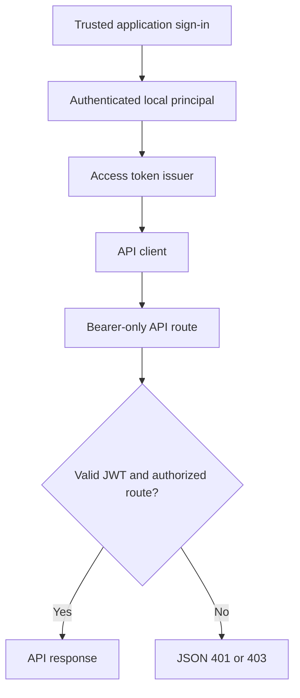
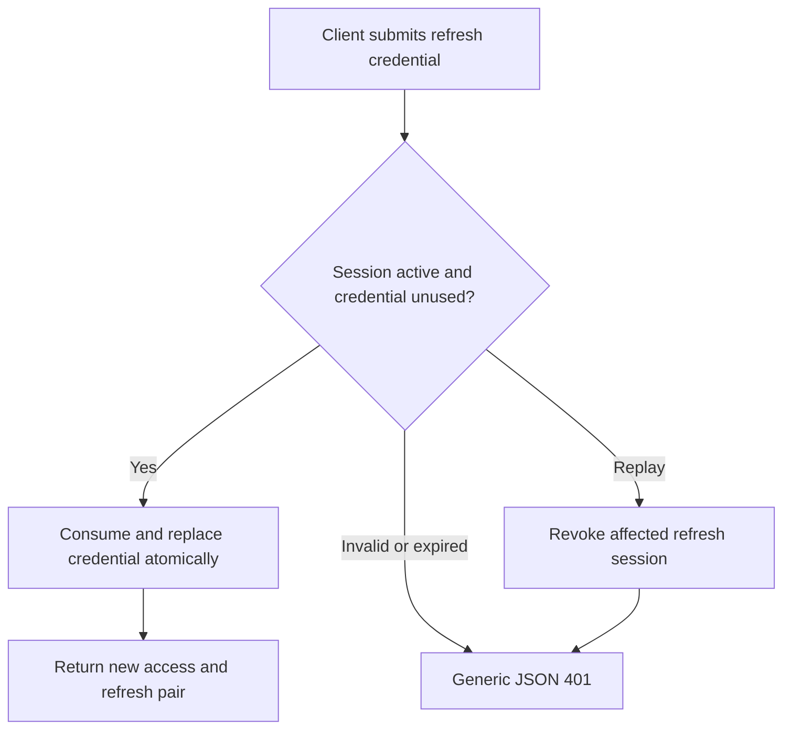

# First-party access and refresh tokens

`base-auth-token` is an optional Maven library for applications that need bearer authentication on selected API routes. Browser sign-in through Google or Apple uses the application's session cookie. Google and Apple ID tokens are consumed by OAuth2 Client during sign-in. Resource Server validates the application's own signed access JWTs on the selected routes.

## Access JWT

| Header or claim | Contract |
| --- | --- |
| `alg` | RS256, using a configured RSA key of at least 2048 bits |
| `typ` | `at+jwt` |
| `kid` | Active signing key identifier. Verification uses the active key or a configured public key before its rotation cutoff. |
| `iss` | Exact application issuer configured in `base.auth.token.issuer` |
| `aud` | A single exact API audience configured in `base.auth.token.audience` |
| `sub` | The existing local user's canonical lowercase UUID |
| `iat`, `nbf` | Issue time in UTC epoch seconds. The token is valid from that time. |
| `exp` | Issue time plus the configured TTL. Default 5 minutes, allowed range 1–900 whole seconds. |
| `jti` | Random UUID unique to the issued JWT |
| `token_use` | `access` |
| `sid` | Refresh-session UUID on tokens issued as part of a token pair. |
| `scope` | Optional space-delimited application scopes drawn from `allowed-scopes` and granted on the trusted authentication as `APP_SCOPE_<name>` |

Verification allows 30 seconds of clock skew and caps the signed lifetime at 15 minutes. Selected endpoint policies can require `SCOPE_<name>` in Spring Security. The default allowlist is empty. Role claims and external provider scopes confer no API permissions. The JWT contains no email, display name, credentials, or provider tokens. Treat its contents as readable by anyone who obtains it.

A consuming application calls `AccessTokenIssuer.issue()` after its authentication flow installs a fully authenticated `LocalUserPrincipal` in Spring Security's current context. The result is a Spring `Jwt` with the signed value and expiry. The caller supplies neither a user ID nor arbitrary JWT claims. The adapter that creates the local principal owns the authentication and local account lookup. The bearer principal resolves to the validated local UUID through `Authentication.getName()`. Its JWT principal cannot be used to issue another token.

## Token pairs and refresh sessions

The demo exposes the following endpoints when the `auth-token` profile is enabled. See the [operating guide](TOKEN_OPERATIONS.md) for setup and request examples.

| Endpoint | Authentication and behavior |
| --- | --- |
| `GET /api/token/csrf` | An authenticated local browser session. Returns the CSRF token and header name with `Cache-Control: no-store`. |
| `POST /api/token/issue` | A fully authenticated local browser session and valid CSRF token. Creates an independent refresh session for the local account. |
| `POST /api/token/refresh` | JSON body `{"refreshToken":"<opaque-credential>"}`. Rotates the credential and returns a new token pair. |
| `POST /api/token/logout` | Bearer access JWT. Revokes the session identified by its `sid` claim for the verified subject. |
| `POST /api/token/logout-all` | Bearer access JWT. Revokes every active refresh session owned by the verified subject. |

Issue and refresh return HTTP 200 with `Cache-Control: no-store` and the JSON fields `accessToken`, `accessExpiresAt`, `refreshToken`, and `refreshExpiresAt`. The expiry fields are UTC timestamps. On refresh, replace the old pair together and serialize refresh requests for each local client session. A duplicate refresh can revoke the family even if the first request already returned its replacement.

Refresh credentials are opaque secrets with 256 bits of entropy. The application persists their SHA-256 digests. Each family lasts 30 days from creation, and rotation keeps the original deadline. Flyway migration V3 creates the two tables in the demo database, and V4 enforces a single unused credential per family. Used hashes are retained through family expiration to detect replay. Operators can call `RefreshSessionService.purgeExpired()` periodically to delete expired families and their credential history. Configure transaction management for the same datasource used by Spring JDBC when integrating the service in another application.

Renewed JWTs carry the same subject, configured audience, and session ID. They carry no application scopes. Obtain a new token pair through trusted local authentication when fresh application scope grants are needed.

An unknown, expired, revoked, or replayed credential receives the same JSON HTTP 401. Replaying a consumed credential from an active family commits revocation of that family. Requests that fail JSON parsing use the application's standard malformed-request response.

Token logout returns HTTP 204 on success, including repeated requests while the access JWT is valid. Current-session logout with a valid JWT that carries no `sid` also returns HTTP 204. The access JWT remains valid until expiry or signing-key retirement. Browser logout ends the local session under the [OIDC session contract](OIDC_AUTHENTICATION_MODEL.md#logout-contract).

The rotation and replay policy follows the approach described in [RFC 9700, section 4.14](https://www.rfc-editor.org/rfc/rfc9700.html#section-4.14).

## Transport and failures

Send the access JWT in the HTTPS `Authorization: Bearer <access-token>` header. Use platform-protected storage on native clients, keep access tokens in memory where practical, and keep credentials out of URLs, telemetry, and logs. Browser clients use the session model by default. If a consuming application exposes token issuance to an authenticated browser session, that state-changing action requires CSRF protection. Use explicit trusted origins for any cross-origin API access.

The bearer chain ignores session cookies. A missing, malformed, invalid, or expired token produces a generic JSON `ApiError` 401 with a `WWW-Authenticate: Bearer` challenge. A verified token that lacks endpoint permission receives JSON 403. Missing or invalid required configuration prevents startup when opt-in is active.

## Configuration and operations

The [operating guide](TOKEN_OPERATIONS.md) covers enabling and disabling the module, client storage, migration rollout, signing-key rotation, and incident recovery.

The JOSE token type follows the `at+jwt` convention described in [RFC 9068](https://www.rfc-editor.org/rfc/rfc9068.html). This application's claim contract is specified above.
